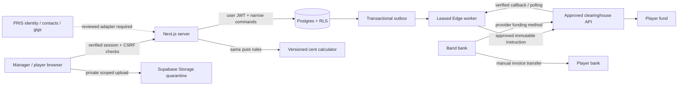
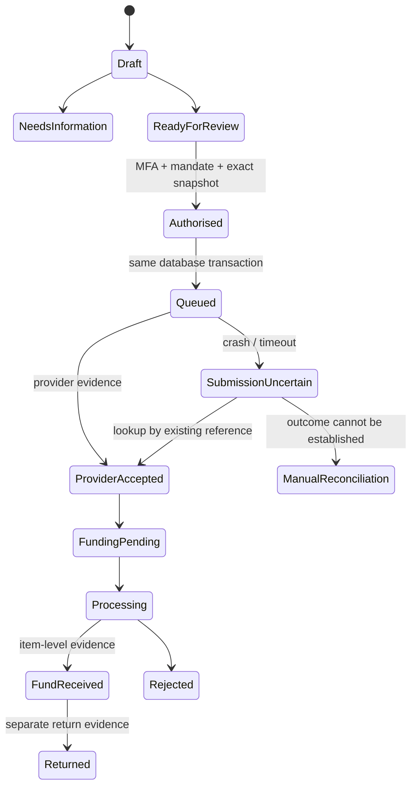
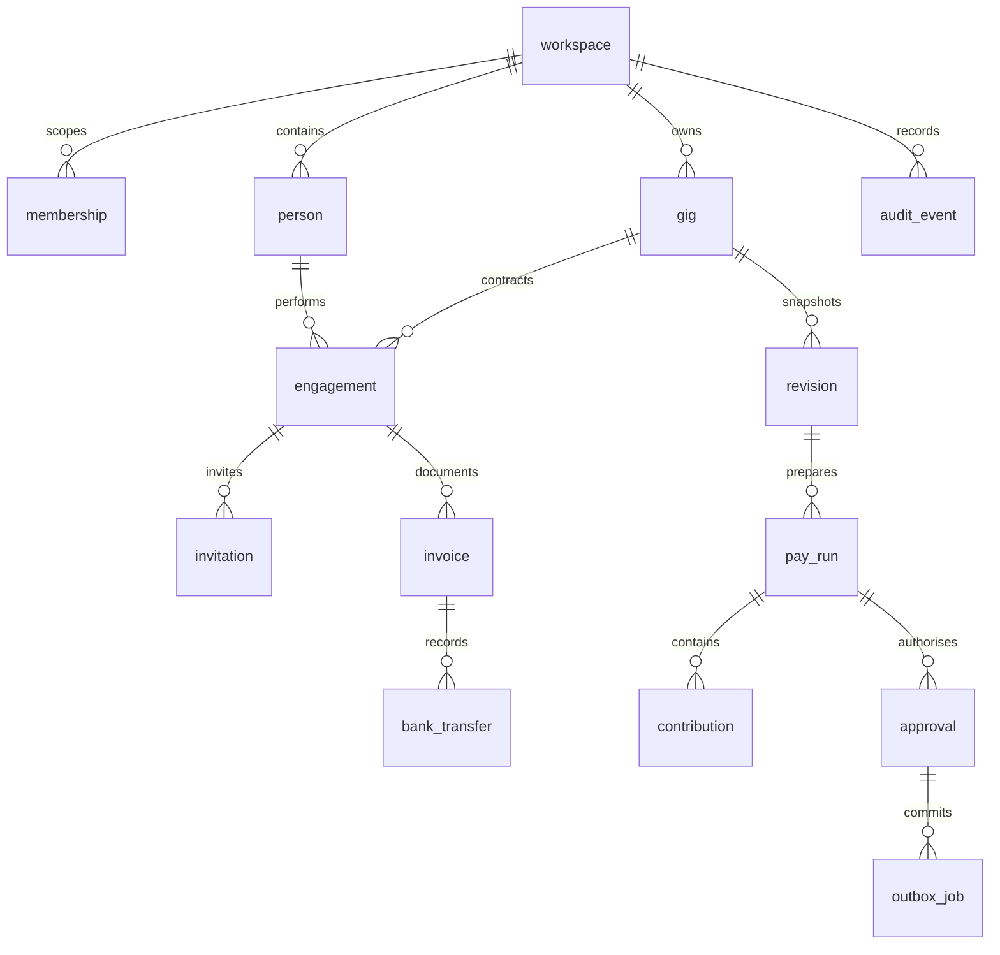

# Band Payments + Super: architecture review

19 October 2026. Written before implementation began. This review does not itself authorise any production migration, invitation, service registration or payment.

## Evidence and decisions

Inspected the original single-file HTML prototype: useful forest-green visual language, inclusive-fee cent search and largest-remainder allocation; fictional people, browser session storage and simulated outcomes must not enter production. Its integer arithmetic is replaced with a tested BigInt-backed shared TypeScript package.

The band already uses a separate CRM for gigs and contacts. Its identity model was not designed for finance-grade authentication, so this app does not trust its tokens or share its database.

**Decision:** create a separate Next.js app with its own Supabase project and a `band_finance` schema. Do not share CRM service credentials. Preserve optional typed CRM references (`src/lib/pris.ts`) for a later reviewed server-side identity/membership adapter. No CRM data import. Finance membership always fails closed and finance access stays explicit even if CRM identity is later linked. Hosting: Cloudflare Workers (via OpenNext) plus a hosted Supabase project in Sydney; see [deployment](deployment.md).

Use Next.js/React/TypeScript with pinned versions and a lockfile, Supabase SSR Auth, Postgres transactions and private Storage. Avoid public registration. One outbox is the only queue. Short-lived Edge workers lease bounded jobs; Supabase Cron is the proposed scheduler. No Redis or in-browser payment work. External payment execution remains unavailable until approved specifications and credentials exist.

Server requests verify Supabase identity with `getUser`, then query current membership using the user's session. RLS independently enforces scope. Server-authoritative calculation payloads are HMAC-attested and checked by a narrow SQL function under that same session: browser clients cannot invent validated amounts. The signing secret lives only on the server and in an unexposed database schema; production provisioning should use a managed secret/Vault path. Canonical payload includes user, workspace, gig, version and expiry. Signing is not payment approval.

Player transfers are manual bank transfers recorded with evidence, explicitly labelled operator-recorded. Super is a separate clearinghouse contribution. Automated contractor invoice/GST transfers are outside v1 unless separately commissioned and provider capability is verified. No wallet, payroll, BAS or tax-profit calculation.

## Trust and data flow

HTTP success, provider acceptance, funding and fund receipt are distinct. A partial batch is never resubmitted wholesale. Externally handled items require evidence and exclude duplicate submission. Expired leases after submission has started enter reconciliation rather than a blind resend.

## Entities

All finance relationships use `(workspace_id, id)` composite keys. A gig draft contains itemised receipts, expenses, reimbursement beneficiaries, reserves, engagements and drawings; immutable revisions preserve exact inputs/results. Separate engagement rows expose only each player's own agreement and breakdown. Personal pages never receive the manager's entire draft. Audit records are append-only to client roles. Environment is explicit on payer/provider settings. No raw bank accounts, member numbers or TFNs are collected in this first build; secure collection is blocked until the approved path is known.

| Capability                           | Owner                    | Finance manager          | Player            | Reviewer                 |
| ------------------------------------ | ------------------------ | ------------------------ | ----------------- | ------------------------ |
| Read whole budget / audit            | Yes                      | Yes                      | No                | Yes                      |
| Edit settlement / create invitations | Yes                      | Yes                      | No                | No                       |
| Own profile, agreement, invoice      | If engaged               | If engaged               | Own only          | No                       |
| Set roles / legal payer              | Explicit admin + MFA     | No                       | No                | No                       |
| Authorise exact pay run              | Only if designated + MFA | Only if designated + MFA | No                | No                       |
| Write verified provider outcomes     | No direct access         | No direct access         | No                | No                       |
| Read private document                | Authorised, scanned only | Authorised, scanned only | Own, scanned only | Authorised, scanned only |

## Provider assessment

Updated research: [19 October clearinghouse assessment](clearinghouse-research-2026-10-19.md). The band has selected AustralianSuper, whose Employer Portal clearinghouse is provided by Wrkr / ClickSuper, as the preferred route to pursue. A partner's personal membership does not establish employer registration or API entitlement. Prioritise AustralianSuper/Wrkr qualification; Beam's inspected public specification and SuperChoice's music-industry precedent remain alternatives. No production integration is approved, and the current generic adapter requires changes before it can implement any real contract.

[Wrkr's published integration page](https://www.wrkr.com.au/software-providers) describes API integration, onboarding, member verification, SMSFs and eligible contractor super. It also advertises wage disbursements; this does not prove support for contractor invoices and GST. [Beam's developer hub](https://beamconnect.com.au/developer-hub/) links its API portal and requires commercial access. Neither is an approved provider for this project. No request URL/body or hosted onboarding capability is inferred from marketing.

Obtain: small-partnership/private-app eligibility; employer registration and mandate; contractor/APRA/SMSF choice and verification; actual OpenAPI/spec version; sandbox credentials/certification; API fees and minimums; contribution categories and cent adjustments; funding method and cut-offs; idempotency and lookup semantics; webhook authentication/replay rules; poll limits; fund-level receipt evidence; returns and corrections; data locations, retention and support escalation. Provider-specific endpoints remain unimplemented until supplied.

## Rules and limits

The shared engine supports reviewed standard adult eligible contractors, uniform taxable invoice lines, a 12% effective-dated SG configuration and exact integer cents. It preserves original fee basis, requires hire evidence and rejects unresolved classifications, employees, under-18/arrears/cap cases and mixed GST. Inclusive arithmetic uses the largest labour-cent amount that fits rounded GST and rounded required SG. Any remainder is a disclosed residual unless provider support for the adjustment is verified. Savings are retained cash, not deductible expenses.

[Creative Workplaces](https://creativeworkplaces.gov.au/contracts-and-payment/superannuation/making-super-payments) and [ATO software developer guidance](https://softwaredevelopers.ato.gov.au/PaydaySuper), checked 19 October 2026, support the current 12% and general seven-business-day fund-receipt framework. Deadline calculation requires a reviewed holiday calendar and exception policy for the actual payday. No weekend-only date is labelled a statutory deadline. An unpaid/missing invoice never erases the obligation.

## Smallest complete first release and acceptance plan

1. Local persistent authenticated manager/player app, tenant RLS, exact calculator and immutable audited revisions. Verify examples, conservation, withholding, reimbursements, crew-once, share rounding, shortfalls and access denial.
2. Invitation creation/claim without automatic email, original-agreement responses, own profile, private quarantine invoices and evidence-based manual bank recording. Verify wrong-email/replay/expiry, stale changes, direct-write denial and mobile journey.
3. Approved provider sandbox, real onboarding, submission/funding and item reconciliation. Verify double approval, lost responses, restarts, callbacks, partial rejection and returns against actual sandbox. A test adapter does not satisfy this stage.
4. Staging deployment, SMTP/domain authentication, scanning, monitoring owner, backup/object restore drill, retention and privacy review; then reviewed production deployment with submission off.
5. Exact real gig, confirmed payer/band/agreements, funding, player onboarding, invoices and the designated approver's approval in the application. Reconcile real transfers and every super item before declaring settlement.

## External dependencies and decisions

Can implement now: local infrastructure, schemas, authenticated portals, arithmetic, invitation/invoice workflows, audit, provider interface, queue controls and tests. Block live activation: selected band/legal partnership and approvers; identity bridge decision; approved hosting project/domain; provider contract/specification/credentials/mandate; secure bank/fund collection; invoice malware scanning; SMTP; reviewed holiday/exception policy and classifications; retention; tested recovery and monitoring owner; actual gig/receipts/agreements/funding. Do not wait for software if payments are already due.

No exact infrastructure pricing is asserted. Cost categories: hosting compute/traffic, Supabase DB/backups/storage/egress, transactional email, malware scanning, provider API/onboarding/minimum fees and ongoing operations. Obtain current quotes before provisioning paid infrastructure. Prefer an available Australian DB region; verify hosting, logs, email, backups, document and provider processing locations separately. Australian-only residency is not established.
